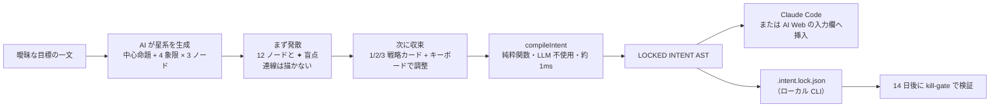
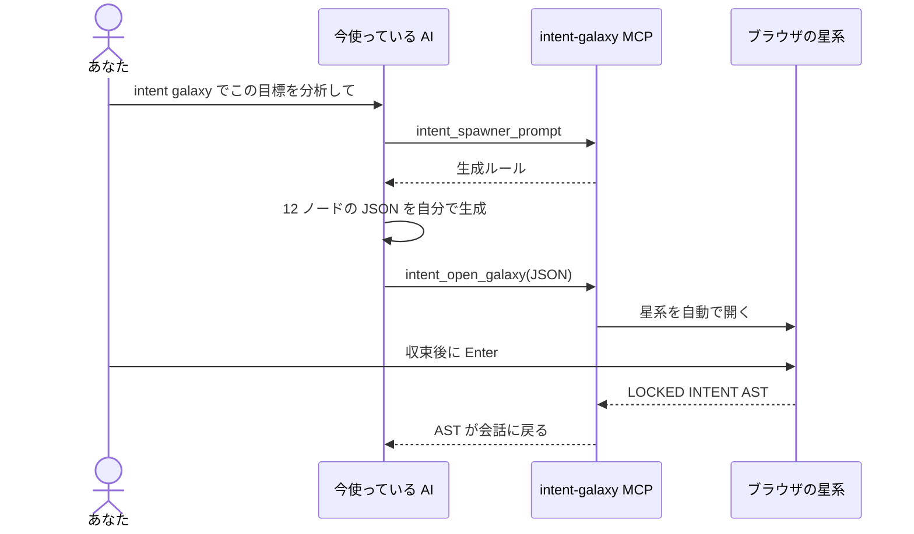
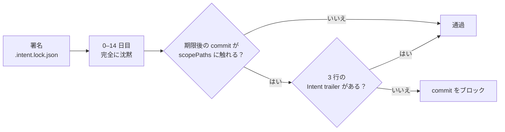
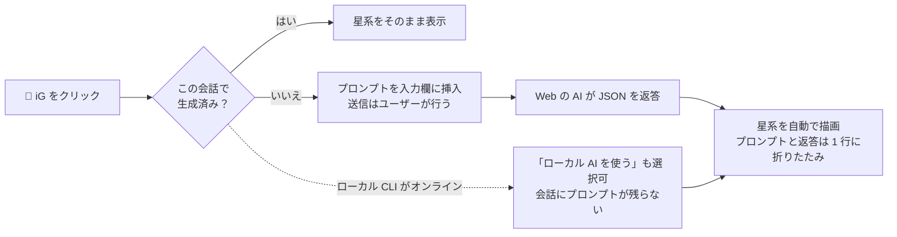

<p align="center">
  <picture>
    <source media="(prefers-color-scheme: dark)" srcset="https://raw.githubusercontent.com/stephen-taipei/intent-galaxy/main/docs/brand/intent-galaxy-logo-dark.svg">
    
  </picture>
</p>

<p align="center">
  <a href="https://github.com/stephen-taipei/intent-galaxy/blob/main/README.md">English</a> ·
  <a href="https://github.com/stephen-taipei/intent-galaxy/blob/main/README.zh-TW.md">繁體中文</a> ·
  <a href="https://github.com/stephen-taipei/intent-galaxy/blob/main/README.zh-CN.md">简体中文</a> ·
  <b>日本語</b> ·
  <a href="https://github.com/stephen-taipei/intent-galaxy/blob/main/README.ko.md">한국어</a>
</p>

# Intent Galaxy

曖昧な目標の一文を「中心命題 + 対立する 4 人の専門家 + 12 個の思考ノード」からなる星系図に展開します。まず発散して盲点を見つけ、キーボードで 1 分以内に収束させ、
最後に**LLM を使わない純粋関数コンパイラ**が決定的な `LOCKED INTENT AST` を生成し、Claude Code や AI Web サービスの入力欄へ直接挿入します。

  

| まず発散：12 ノードと ✦ 盲点、連線は描かない | 次に収束：`1` で主軸を点灯、右側で AST をリアルタイムにコンパイル |
| --- | --- |
|  |  |

<p align="center">
  <a href="#クイックスタート">クイックスタート</a> ·
  <a href="#仕組み">仕組み</a> ·
  <a href="#対応-ai">対応 AI</a> ·
  <a href="#mcp-として登録">MCP</a> ·
  <a href="#14-日後の答え合わせkill-gate">Kill-gate</a> ·
  <a href="#キーボード操作">キーボード操作</a> ·
  <a href="#ブラウザ拡張機能">拡張機能</a> ·
  <a href="#開発">開発</a>
</p>

<br>

## 3 つの使い方

| 形態 | 対象 | 内容 | 状態 |
| ---- | ---- | ---- | :--: |
| **CLI** | エンジニア | `npx @stephen.taipei/intent-galaxy`：127.0.0.1 の星系サーバー。生成には Claude、Codex、Gemini、agy CLI または 12 社の API を選択可能 | ✅ |
| **MCP** | エンジニア | Stdio MCP Server：`intent_spawner_prompt` → `intent_open_galaxy`。Claude Code、Codex、Gemini CLI、agy から利用可能 | ✅ |
| **Extension** | 一般ユーザー | Chrome / Firefox：Claude、ChatGPT、Gemini、Grok、DeepSeek、Qwen、Perplexity、Copilot、Mistral、Kimi の入力欄の横に `🌌 iG` カプセルを追加し、そのサイトの AI に星系を生成させる | ✅ |
| **Kill-gate** | エンジニア | `.intent.lock.json`（RFC 8785 JCS + SHA-256）と、14 日後の commit を検証するゲートキーパー | ✅ |

<br>

---

## 仕組み



| 象限 | 役割 | `x` で除外したとき |
| :--: | ---- | ---- |
| Q1 | ゼロベース派 | `MUST NOT` |
| Q2 | ベテラン | `MUST NOT` |
| Q3 | 越境者 | `MUST NOT` |
| Q4 | 検死官（反証ノード） | `ACCEPTED RISK`（リスクを明示的に引き受ける。禁止ではない） |

<br>

---

## クイックスタート

> 必要環境：Node ≥ 22.18。星系の生成には、下記[対応 AI](#対応-ai)のいずれか（ログイン済みの CLI、または設定済みの API key）も必要です。

```bash
cd ~/code/some-repo
npx @stephen.taipei/intent-galaxy
```

http://127.0.0.1:4787 を開き、目標を一文入力して Enter を押すと星系が生成されます。

| 主なオプション | 用途 |
| --- | --- |
| `--port 4300` | 別のポートを使う（デフォルト 4787） |
| `--no-open` | ブラウザを自動で開かない |
| `--provider gemini` | デフォルトの AI を指定。Web 画面の右上でも切り替え可能 |
| `--model <id>` | モデルを指定（`INTENT_GALAXY_MODEL` でも可） |

| 動作 | 説明 |
| --- | --- |
| ネットワーク | `127.0.0.1` のみにバインド。リクエストごとに Host（DNS rebinding 対策）、POST の送信元、パストラバーサルを検査 |
| API key | 環境変数からのみ読み込み、ローカルサーバー内に留まる。ブラウザには送信されない |
| AI の選択 | 画面上部で AI とモデルを選択可能。検出できない選択肢には不足しているものを表示（例：「OPENAI_API_KEY を設定してください」） |
| 速度 | Claude CLI はデフォルトで Opus を使用し、約 3–4 分かかる |
| ロック | Enter でロックすると、カレントディレクトリに `.intent.lock.json` を書き込む |

<br>

---

## 対応 AI

| 種類 | プロバイダー（`--provider`） | 必要なもの |
| --- | --- | --- |
| ローカル CLI（API key 不要） | `claude` Claude Code、`codex` OpenAI Codex、`gemini` Gemini CLI、`agy` Antigravity | ログイン済みの CLI が `PATH` 上にあること |
| ローカルのオープンモデル | `ollama`（Llama、Qwen、Gemma…） | Ollama が `127.0.0.1:11434` で起動していること |
| その他 | `custom` 任意の OpenAI 互換エンドポイント | `INTENT_GALAXY_OPENAI_BASE_URL`（任意で `INTENT_GALAXY_OPENAI_API_KEY`） |

**API プロバイダー**

| `--provider` | モデル | 環境変数 |
| --- | --- | --- |
| `anthropic` | Claude | `ANTHROPIC_API_KEY` |
| `openai` | GPT | `OPENAI_API_KEY` |
| `google` | Gemini | `GEMINI_API_KEY` |
| `xai` | Grok | `XAI_API_KEY` |
| `deepseek` | DeepSeek | `DEEPSEEK_API_KEY` |
| `mistral` | Mistral | `MISTRAL_API_KEY` |
| `qwen` | 通義千問 | `DASHSCOPE_API_KEY` |
| `moonshot` | Kimi | `MOONSHOT_API_KEY` |
| `groq` | Groq | `GROQ_API_KEY` |
| `openrouter` | OpenRouter | `OPENROUTER_API_KEY` |

API プロバイダーのモデル一覧はプロバイダーにリアルタイムで問い合わせます。CLI は読み取り専用／プランモードで実行され、ファイルを変更しません。

<br>

---

## MCP として登録

Claude Code、Codex、Gemini CLI、agy に対応：

```bash
claude mcp add intent-galaxy -- npx -y @stephen.taipei/intent-galaxy
codex mcp add intent-galaxy -- npx -y @stephen.taipei/intent-galaxy
gemini mcp add intent-galaxy npx -y @stephen.taipei/intent-galaxy
agy mcp add intent-galaxy npx -y @stephen.taipei/intent-galaxy
```

会話の中で「intent galaxy でこの目標を分析して」と頼むだけです。星系は今使っている AI（Claude Code、Codex など）自身が生成し、別のモデルを呼び出すことはありません：



<br>

---

## 14 日後の答え合わせ（kill-gate）

```bash
npx @stephen.taipei/intent-galaxy init-hook
```

| インストール先 | 内容 |
| --- | --- |
| `.intent/hooks/` | `kill-gate.mjs` をコピー |
| `commit-msg` | husky があれば `.husky/commit-msg` に追記。なければ `core.hooksPath` が未設定の場合に `.intent/hooks` を設定 |
| GitHub PR | `intent-kill` をチェック |
| Claude Code | `SessionStart` hook |



期限後に `scopePaths` に触れる commit には、次の記載が必須です：

```text
Intent-Lock: <specHash>
Intent-Kill: alive|dead|unobservable
Intent-Kill-Evidence: <12 文字以上：実際に見た数値、または欠けている数値>
```

<br>

---

## キーボード操作

| 分類 | キー | 動作 |
| :--- | :--- | :--- |
| 戦略 | `1` `2` `3` | alpha / beta / gamma 戦略カードを適用（手動の上書きは保持）。`Shift` + 数字で上書きをクリア |
| ナビゲーション | `h` `j` `k` `l` | 極座標の半平面で最も近いノードへフォーカスを移動 |
| ナビゲーション | `g` + `f/d/l/p` + `1-3` | 象限のノードへ直接ジャンプ（`g l 1` → N7） |
| 決定 | `Space` / `i` | 採用（include） |
| 決定 | `x` | 除外ガードレール。Q4 ノードでは「リスクの明示的な引き受け」 |
| 決定 | `0` / `n` | 今回は無視 |
| 衝突 | `c` / `r` | 衝突ノードへジャンプ / 新しい方の決定を残して衝突を解消 |
| 履歴 | `u` / `Ctrl+r` | 元に戻す / やり直す |
| 終了 | `Enter` / `Esc` | ロックして挿入 / パネルを閉じる |

> 日本語入力（IME）がオンのままでも利用できます（`e.code` を読み取るため）。

<br>

---

## ブラウザ拡張機能

```bash
npm run build:ext    # apps/extension と apps/extension-firefox に同期。そのまま「パッケージ化されていない拡張機能を読み込む」で使える
npm run pack:ext     # ストア公開用に dist-ext/intent-galaxy-{chrome,firefox}-<version>.zip も生成
```

入力欄に迷っていることを一文書いて、`🌌 iG`（またはツールバーのアイコン、`Cmd/Ctrl+Shift+G`）をクリック：



| 機能 | 説明 |
| --- | --- |
| 生成元 | デフォルトでは現在のサイトの AI に依頼（会話の文脈が見える）。ローカル CLI がオンラインなら「ローカル AI を使う」ボタンが追加される。拡張機能が自動送信することはない |
| 折りたたみ | 拡張機能自身が送信し、確実に識別できるメッセージだけを折りたたむ。サイト構造を認識できない場合は折りたたまない。クリックで展開可能 |
| 待ち時間 | 推論系の上位モデルでは 5–15 分かかることがある。20 秒を超えると通知され、パネルを縮小しておける。完了するとボタンに「✓ 星系完成」と表示 |
| 返答が読めない | サイトが長いコードブロックを折りたたんでいる場合は「JSON を貼り付け」で手動読み込み |
| 記憶 | 同じ会話を開き直したりリロードしたりすると、生成済みの星系をそのまま表示。データは拡張機能内にのみ 30 日間保存。シークレットウィンドウと ChatGPT の一時チャットでは保存しない |
| プライバシー | パネルとページ間の通信は拡張機能の内部メッセージのみ。サイト側のスクリプトからは質問内容も星系も読めない |
| ロックファイル | `.intent.lock.json` を書き込むのはローカル CLI で生成した星系のみ。Web の AI、貼り付け、デモの星系はプランを入力欄に戻すだけ |
| パネル | タイトルバーをドラッグで移動、右下をドラッグでリサイズ、タイトルバーをダブルクリックで最大化。透明度も調整可能 |
| デモ | 入力欄が空のとき、待ち時間なしのデモを 3 つ用意：食洗機選び、甘酸っぱくて重くない食べ物、マルチテーマのフロントエンド設計 |

<br>

---

## 開発

| コマンド | 用途 |
| --- | --- |
| `npm test` | libs の単体テスト、CLI の結合テスト、拡張機能の同期、npm pack の E2E テスト |
| `npm start` | ソースから直接起動（Node ランタイムが TypeScript の型を除去） |
| `npm run build` | `dist/` を生成（npm パッケージの中身。npm pack / publish の前に自動実行） |
| `npm run bench:latency -- --providers claude,codex` | 固定の 10 問で生成レイテンシを計測（実際にモデルを呼び出す）。結果は `bench/latency.jsonl` に出力 |

アーキテクチャとデータ構造は [`INTENT-SPEC-FINAL.md`](INTENT-SPEC-FINAL.md) を正とします。

README は 5 言語あります。どれかを変更したら `README.md`、`README.zh-TW.md`、`README.zh-CN.md`、`README.ja.md`、`README.ko.md` をすべて更新してください（`npm test` が構造の一致をチェックします）。

### リリース

1. `package.json` のバージョンと [`CHANGELOG.md`](CHANGELOG.md) を更新し（`## X.Y.Z — 日付` のセクションを追加）、`npm run build:ext` を実行して拡張機能の manifest のバージョンを揃えてから（`npm test` でチェックされる）、`main` にマージ
2. `main` 上で `npm publish --access public`
3. `git tag vX.Y.Z && git push origin vX.Y.Z`：[Release workflow](.github/workflows/release.yml) が tag、`package.json`、npm のバージョンが一致することを確認し、CHANGELOG の該当セクションから GitHub Release を作成（npm への公開は行わない）

<br>

---

## License

[Apache-2.0](LICENSE)
