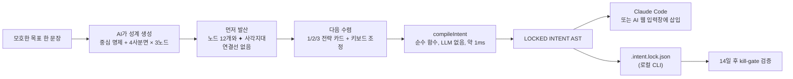
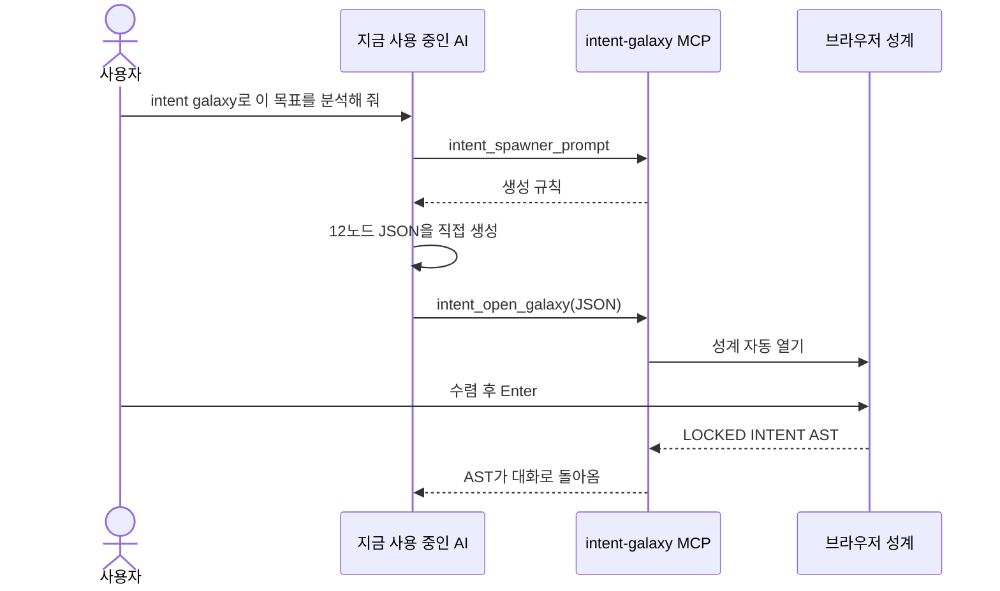
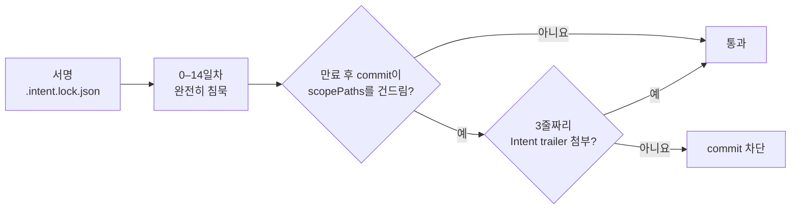
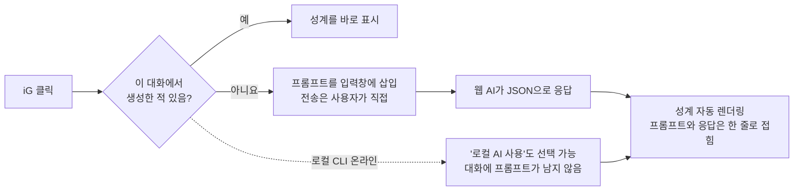

<p align="center">
  <picture>
    <source media="(prefers-color-scheme: dark)" srcset="https://raw.githubusercontent.com/stephen-taipei/intent-galaxy/main/docs/brand/intent-galaxy-logo-dark.svg">
    
  </picture>
</p>

<p align="center">
  <a href="https://github.com/stephen-taipei/intent-galaxy/blob/main/README.md">English</a> ·
  <a href="https://github.com/stephen-taipei/intent-galaxy/blob/main/README.zh-TW.md">繁體中文</a> ·
  <a href="https://github.com/stephen-taipei/intent-galaxy/blob/main/README.zh-CN.md">简体中文</a> ·
  <a href="https://github.com/stephen-taipei/intent-galaxy/blob/main/README.ja.md">日本語</a> ·
  <b>한국어</b>
</p>

# Intent Galaxy

모호한 목표 한 문장을 '중심 명제 + 대립하는 전문가 4명 + 생각 노드 12개'로 이루어진 성계도로 펼칩니다. 먼저 발산해서 사각지대를 확인하고, 키보드로 1분 안에 수렴한 뒤,
**LLM 없는 순수 함수 컴파일러**가 결정적인 `LOCKED INTENT AST`를 만들어 Claude Code나 AI 웹 서비스의 입력창에 바로 넣어 줍니다.

  

| 먼저 발산: 노드 12개와 ✦ 사각지대, 연결선 없음 | 다음 수렴: `1`을 누르면 주축이 켜지고 오른쪽에서 AST를 실시간 컴파일 |
| --- | --- |
|  |  |

<p align="center">
  <a href="#빠른-시작">빠른 시작</a> ·
  <a href="#작동-방식">작동 방식</a> ·
  <a href="#지원-ai">지원 AI</a> ·
  <a href="#mcp로-등록">MCP</a> ·
  <a href="#14일-후-반증-검사-kill-gate">Kill-gate</a> ·
  <a href="#키보드-조작">키보드 조작</a> ·
  <a href="#브라우저-확장-프로그램">확장 프로그램</a> ·
  <a href="#개발">개발</a>
</p>

<br>

## 세 가지 사용 방식

| 형태 | 대상 | 내용 | 상태 |
| ---- | ---- | ---- | :--: |
| **CLI** | 엔지니어 | `npx @stephen.taipei/intent-galaxy`: 127.0.0.1 성계 서버. 생성에 Claude, Codex, Gemini, agy CLI 또는 12개 API 중 선택 가능 | ✅ |
| **MCP** | 엔지니어 | Stdio MCP Server: `intent_spawner_prompt` → `intent_open_galaxy`. Claude Code, Codex, Gemini CLI, agy에 모두 연결 가능 | ✅ |
| **Extension** | 일반 사용자 | Chrome / Firefox: Claude, ChatGPT, Gemini, Grok, DeepSeek, Qwen, Perplexity, Copilot, Mistral, Kimi 입력창 옆에  **iG** 캡슐을 추가해 해당 사이트의 AI가 바로 성계를 생성 | ✅ |
| **Kill-gate** | 엔지니어 | `.intent.lock.json`(RFC 8785 JCS + SHA-256)과 14일 후 commit을 검증하는 게이트키퍼 | ✅ |

<br>

---

## 작동 방식



| 사분면 | 역할 | `x`로 제외했을 때 |
| :--: | ---- | ---- |
| Q1 | 원점 재검토자 | `MUST NOT` |
| Q2 | 베테랑 | `MUST NOT` |
| Q3 | 경계 파괴자 | `MUST NOT` |
| Q4 | 검시관(반증 노드) | `ACCEPTED RISK`(위험을 명시적으로 감수, 금지가 아님) |

<br>

---

## 빠른 시작

> 요구 사항: Node ≥ 22.18. 성계를 생성하려면 아래 [지원 AI](#지원-ai) 중 하나(로그인된 CLI 또는 설정된 API key)도 필요합니다.

```bash
cd ~/code/some-repo
npx @stephen.taipei/intent-galaxy
```

http://127.0.0.1:4787 을 열고 목표 한 문장을 입력한 뒤 Enter를 누르면 성계가 생성됩니다.

| 주요 옵션 | 용도 |
| --- | --- |
| `--port 4300` | 다른 포트 사용(기본값 4787) |
| `--no-open` | 브라우저를 자동으로 열지 않음 |
| `--provider gemini` | 기본 AI 지정. 웹 화면 오른쪽 위에서도 전환 가능 |
| `--model <id>` | 모델 지정(`INTENT_GALAXY_MODEL`로도 가능) |

| 동작 | 설명 |
| --- | --- |
| 네트워크 | `127.0.0.1`에만 바인딩. 모든 요청에서 Host(DNS rebinding 방지), POST 출처, 경로 탐색을 검사 |
| API key | 환경 변수에서만 읽고 로컬 서버에만 머무름. 브라우저로 전송되지 않음 |
| AI 선택 | 화면 상단에서 AI와 모델 선택 가능. 감지되지 않는 항목에는 무엇이 빠졌는지 표시(예: 'OPENAI_API_KEY를 설정하세요') |
| 속도 | Claude CLI는 기본으로 Opus를 사용하며 약 3–4분 소요 |
| 잠금 | Enter로 잠그면 현재 디렉터리에 `.intent.lock.json`을 기록 |

<br>

---

## 지원 AI

| 유형 | 제공자(`--provider`) | 필요 조건 |
| --- | --- | --- |
| 로컬 CLI(API key 불필요) | `claude` Claude Code, `codex` OpenAI Codex, `gemini` Gemini CLI, `agy` Antigravity | 로그인된 CLI가 `PATH`에 있어야 함 |
| 로컬 오픈 모델 | `ollama`(Llama, Qwen, Gemma…) | Ollama가 `127.0.0.1:11434`에서 실행 중 |
| 기타 | `custom` 모든 OpenAI 호환 엔드포인트 | `INTENT_GALAXY_OPENAI_BASE_URL`(선택적으로 `INTENT_GALAXY_OPENAI_API_KEY`) |

**API 제공자**

| `--provider` | 모델 | 환경 변수 |
| --- | --- | --- |
| `anthropic` | Claude | `ANTHROPIC_API_KEY` |
| `openai` | GPT | `OPENAI_API_KEY` |
| `google` | Gemini | `GEMINI_API_KEY` |
| `xai` | Grok | `XAI_API_KEY` |
| `deepseek` | DeepSeek | `DEEPSEEK_API_KEY` |
| `mistral` | Mistral | `MISTRAL_API_KEY` |
| `qwen` | 통이첸원(Qwen) | `DASHSCOPE_API_KEY` |
| `moonshot` | Kimi | `MOONSHOT_API_KEY` |
| `groq` | Groq | `GROQ_API_KEY` |
| `openrouter` | OpenRouter | `OPENROUTER_API_KEY` |

API 제공자의 모델 목록은 제공자에게 실시간으로 조회합니다. CLI는 읽기 전용/계획 모드로 실행되며 파일을 수정하지 않습니다.

<br>

---

## MCP로 등록

Claude Code, Codex, Gemini CLI, agy를 지원합니다:

```bash
claude mcp add intent-galaxy -- npx -y @stephen.taipei/intent-galaxy
codex mcp add intent-galaxy -- npx -y @stephen.taipei/intent-galaxy
gemini mcp add intent-galaxy npx -y @stephen.taipei/intent-galaxy
agy mcp add intent-galaxy npx -y @stephen.taipei/intent-galaxy
```

대화에서 "intent galaxy로 이 목표를 분석해 줘"라고 요청하세요. 성계는 지금 사용 중인 AI(Claude Code, Codex 등)가 직접 생성하며, 다른 모델을 따로 호출하지 않습니다:



<br>

---

## 14일 후 반증 검사 (kill-gate)

```bash
npx @stephen.taipei/intent-galaxy init-hook
```

| 설치 위치 | 방식 |
| --- | --- |
| `.intent/hooks/` | `kill-gate.mjs` 복사 |
| `commit-msg` | husky가 있으면 `.husky/commit-msg`에 추가. 없으면 `core.hooksPath`가 비어 있을 때 `.intent/hooks`로 설정 |
| GitHub PR | `intent-kill` 검사 |
| Claude Code | `SessionStart` hook |



만료 후 `scopePaths`를 건드리는 commit에는 다음을 반드시 첨부해야 합니다:

```text
Intent-Lock: <specHash>
Intent-Kill: alive|dead|unobservable
Intent-Kill-Evidence: <최소 12자: 직접 확인한 수치, 또는 부족한 바로 그 수치>
```

<br>

---

## 키보드 조작

| 분류 | 키 | 동작 |
| :--- | :--- | :--- |
| 전략 | `1` `2` `3` | alpha / beta / gamma 전략 카드 적용(수동 재정의는 유지). `Shift` + 숫자로 재정의 초기화 |
| 탐색 | `h` `j` `k` `l` | 극좌표 반평면에서 가장 가까운 노드로 포커스 이동 |
| 탐색 | `g` + `f/d/l/p` + `1-3` | 사분면 노드로 바로 이동(`g l 1` → N7) |
| 결정 | `Space` / `i` | 채택(include) |
| 결정 | `x` | 제외 가드레일. Q4 노드에서는 '위험의 명시적 감수' |
| 결정 | `0` / `n` | 이번에는 무시 |
| 충돌 | `c` / `r` | 충돌 노드로 이동 / 더 최근 결정을 남겨 충돌 해소 |
| 기록 | `u` / `Ctrl+r` | 실행 취소 / 다시 실행 |
| 종료 | `Enter` / `Esc` | 잠그고 삽입 / 패널 닫기 |

> 한글 입력기가 켜져 있어도 그대로 동작합니다(`e.code`를 읽기 때문).

<br>

---

## 브라우저 확장 프로그램

```bash
npm run build:ext    # apps/extension과 apps/extension-firefox에 동기화. 바로 '압축해제된 확장 프로그램을 로드'로 사용 가능
npm run pack:ext     # 스토어 등록용 dist-ext/intent-galaxy-{chrome,firefox}-<version>.zip도 생성
```

입력창에 고민 중인 일을 한 문장 적고  **iG**(또는 툴바 아이콘, `Cmd/Ctrl+Shift+G`)를 클릭하세요:



| 기능 | 설명 |
| --- | --- |
| 생성 주체 | 기본값은 현재 사이트의 AI(대화 맥락을 볼 수 있음). 로컬 CLI가 온라인이면 '로컬 AI 사용' 버튼이 추가됨. 확장 프로그램이 자동으로 전송하지 않음 |
| 접기 | 확장 프로그램이 직접 보냈고 확실히 식별할 수 있는 메시지만 접음. 사이트 구조를 인식하지 못하면 접지 않으며, 클릭하면 펼쳐짐 |
| 대기 | 추론형 상위 모델은 5–15분 걸릴 수 있음. 20초가 넘으면 안내가 뜨고 패널을 최소화해 둘 수 있으며, 완료되면 버튼에 '✓ 성계 완성' 표시 |
| 응답을 못 읽을 때 | 사이트가 긴 코드 블록을 접어 둔 경우 'JSON 붙여넣기'로 직접 불러오기 |
| 기억 | 같은 대화를 다시 열거나 새로고침하면 생성된 성계를 바로 표시. 확장 프로그램 안에만 30일간 저장. 시크릿 창과 ChatGPT 임시 채팅에서는 저장하지 않음 |
| 개인정보 | 패널과 페이지 사이는 확장 프로그램 내부 메시지로만 통신하므로 사이트 자체 스크립트는 질문과 성계를 읽을 수 없음 |
| 잠금 파일 | `.intent.lock.json`은 로컬 CLI로 생성한 성계만 기록. 웹 AI, 붙여넣기, 데모 성계는 방안을 입력창에 다시 채우기만 함 |
| 패널 | 제목 표시줄을 드래그해 이동, 오른쪽 아래 모서리를 드래그해 크기 조절, 제목 표시줄을 더블클릭해 최대화. 투명도 조절 가능 |
| 데모 | 입력창이 비어 있으면 기다릴 필요 없는 데모 3개 제공: 식기세척기 고르기, 새콤달콤하면서 부담 없는 음식, 멀티 테마 프런트엔드 아키텍처 |

<br>

---

## 개발

| 명령 | 용도 |
| --- | --- |
| `npm test` | libs 단위 테스트, CLI 통합 테스트, 확장 프로그램 동기화, npm pack E2E 테스트 |
| `npm start` | 소스에서 바로 실행(Node 런타임이 TypeScript 타입을 제거) |
| `npm run build` | `dist/` 생성(npm 패키지 내용. npm pack / publish 전에 자동 실행) |
| `npm run bench:latency -- --providers claude,codex` | 고정된 10개 문제로 생성 지연 시간 측정(실제로 모델을 호출). 결과는 `bench/latency.jsonl`에 기록 |

아키텍처와 데이터 구조는 [`INTENT-SPEC-FINAL.md`](INTENT-SPEC-FINAL.md)를 기준으로 합니다.

README는 5개 언어로 제공됩니다. 하나를 수정하면 `README.md`, `README.zh-TW.md`, `README.zh-CN.md`, `README.ja.md`, `README.ko.md`를 모두 함께 수정하세요(`npm test`가 구조 일치를 검사합니다).

### 릴리스

1. `package.json` 버전과 [`CHANGELOG.md`](CHANGELOG.md)를 업데이트하고(`## X.Y.Z — 날짜` 섹션 추가), `npm run build:ext`를 실행해 확장 프로그램 manifest 버전을 맞춘 뒤(`npm test`가 검사함) `main`에 병합
2. `main`에서 `npm publish --access public`
3. `git tag vX.Y.Z && git push origin vX.Y.Z`: [Release workflow](.github/workflows/release.yml)가 tag, `package.json`, npm 버전이 일치하는지 확인한 뒤 CHANGELOG의 해당 섹션으로 GitHub Release를 생성(npm에는 배포하지 않음)

<br>

---

## License

[Apache-2.0](LICENSE)
