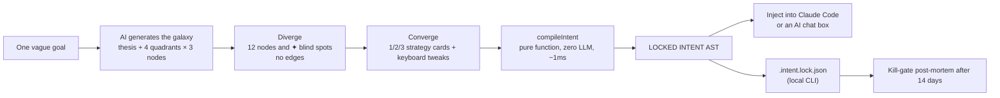
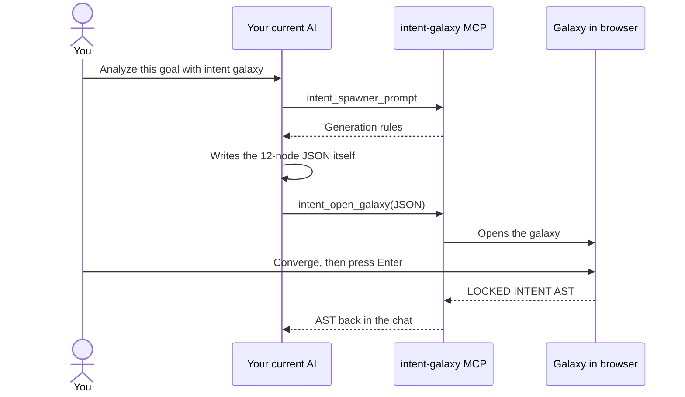
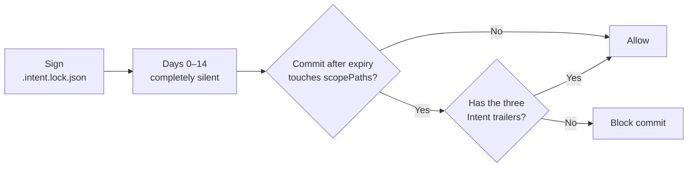
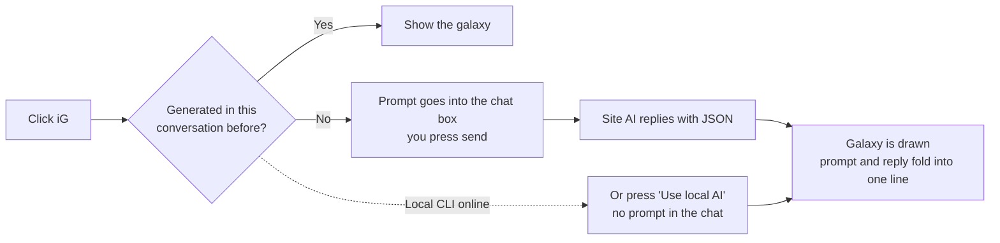

<p align="center">
  <picture>
    <source media="(prefers-color-scheme: dark)" srcset="https://raw.githubusercontent.com/stephen-taipei/intent-galaxy/main/docs/brand/intent-galaxy-logo-dark.svg">
    
  </picture>
</p>

<p align="center">
  <b>English</b> ·
  <a href="https://github.com/stephen-taipei/intent-galaxy/blob/main/README.zh-TW.md">繁體中文</a> ·
  <a href="https://github.com/stephen-taipei/intent-galaxy/blob/main/README.zh-CN.md">简体中文</a> ·
  <a href="https://github.com/stephen-taipei/intent-galaxy/blob/main/README.ja.md">日本語</a> ·
  <a href="https://github.com/stephen-taipei/intent-galaxy/blob/main/README.ko.md">한국어</a>
</p>

# Intent Galaxy

Turn one vague goal into a galaxy: a central thesis, 4 adversarial experts and 12 thought nodes. Diverge first to see your blind spots, converge in about a minute with the keyboard,
then a **zero-LLM pure-function compiler** produces a deterministic `LOCKED INTENT AST` and injects it straight into Claude Code or an AI chat box.

  

| Diverge: 12 nodes and ✦ blind spots, no edges | Converge: press `1` to light the main path, AST compiles live on the right |
| --- | --- |
|  |  |

<p align="center">
  <a href="#quick-start">Quick start</a> ·
  <a href="#how-it-works">How it works</a> ·
  <a href="#supported-ai">Supported AI</a> ·
  <a href="#register-as-mcp">MCP</a> ·
  <a href="#14-day-kill-gate">Kill-gate</a> ·
  <a href="#keyboard">Keyboard</a> ·
  <a href="#browser-extension">Extension</a> ·
  <a href="#development">Development</a>
</p>

<br>

## Three ways to use it

| Form | For | What | Status |
| ---- | ---- | ---- | :--: |
| **CLI** | Engineers | `npx @stephen.taipei/intent-galaxy`: galaxy server on 127.0.0.1, generates with the Claude, Codex, Gemini or agy CLI, or 12 APIs | ✅ |
| **MCP** | Engineers | Stdio MCP server: `intent_spawner_prompt` → `intent_open_galaxy`; works with Claude Code, Codex, Gemini CLI and agy | ✅ |
| **Extension** | Everyone | Chrome / Firefox: adds a  **iG** pill next to the chat box on Claude, ChatGPT, Gemini, Grok, DeepSeek, Qwen, Perplexity, Copilot, Mistral and Kimi, and asks that site's own AI to generate the galaxy | ✅ |
| **Kill-gate** | Engineers | `.intent.lock.json` (RFC 8785 JCS + SHA-256) plus a commit post-mortem gate 14 days later | ✅ |

<br>

---

## How it works



| Quadrant | Role | When excluded with `x` |
| :--: | ---- | ---- |
| Q1 | Zero-baser | `MUST NOT` |
| Q2 | Veteran | `MUST NOT` |
| Q3 | Boundary-crosser | `MUST NOT` |
| Q4 | Coroner (falsification node) | `ACCEPTED RISK` (risk explicitly accepted, not forbidden) |

<br>

---

## Quick start

> Requires Node ≥ 22.18. Generating a galaxy also needs one of the [Supported AI](#supported-ai) below (a signed-in CLI or an API key).

```bash
cd ~/code/some-repo
npx @stephen.taipei/intent-galaxy
```

Open http://127.0.0.1:4787, type a goal and press Enter to generate a galaxy.

| Common flags | Purpose |
| --- | --- |
| `--port 4300` | Use another port (default 4787) |
| `--no-open` | Don't open the browser |
| `--provider gemini` | Default AI; can also be switched at the top right of the page |
| `--model <id>` | Model to use (or `INTENT_GALAXY_MODEL`) |

| Behavior | Details |
| --- | --- |
| Network | Binds `127.0.0.1` only; every request checks Host (DNS rebinding), POST origin and path traversal |
| API keys | Read from environment variables only and kept in the local server, never sent to the browser |
| Choosing AI | Pick the AI and model at the top of the page; unavailable options say what's missing (e.g. "set OPENAI_API_KEY") |
| Speed | Claude CLI defaults to Opus and takes about 3–4 minutes |
| Lock | Pressing Enter to lock writes `.intent.lock.json` in the current directory |

<br>

---

## Supported AI

| Type | Provider (`--provider`) | Needs |
| --- | --- | --- |
| Local CLI (no API key) | `claude` Claude Code, `codex` OpenAI Codex, `gemini` Gemini CLI, `agy` Antigravity | A signed-in CLI on `PATH` |
| Local open models | `ollama` (Llama, Qwen, Gemma…) | Ollama running at `127.0.0.1:11434` |
| Other | `custom` any OpenAI-compatible endpoint | `INTENT_GALAXY_OPENAI_BASE_URL` (optional `INTENT_GALAXY_OPENAI_API_KEY`) |

**API providers**

| `--provider` | Models | Environment variable |
| --- | --- | --- |
| `anthropic` | Claude | `ANTHROPIC_API_KEY` |
| `openai` | GPT | `OPENAI_API_KEY` |
| `google` | Gemini | `GEMINI_API_KEY` |
| `xai` | Grok | `XAI_API_KEY` |
| `deepseek` | DeepSeek | `DEEPSEEK_API_KEY` |
| `mistral` | Mistral | `MISTRAL_API_KEY` |
| `qwen` | Qwen | `DASHSCOPE_API_KEY` |
| `moonshot` | Kimi | `MOONSHOT_API_KEY` |
| `groq` | Groq | `GROQ_API_KEY` |
| `openrouter` | OpenRouter | `OPENROUTER_API_KEY` |

Model lists for API providers are fetched live from the provider. CLIs run in read-only / plan mode and never modify files.

<br>

---

## Register as MCP

Works with Claude Code, Codex, Gemini CLI and agy:

```bash
claude mcp add intent-galaxy -- npx -y @stephen.taipei/intent-galaxy
codex mcp add intent-galaxy -- npx -y @stephen.taipei/intent-galaxy
gemini mcp add intent-galaxy npx -y @stephen.taipei/intent-galaxy
agy mcp add intent-galaxy npx -y @stephen.taipei/intent-galaxy
```

Ask it to "analyze this goal with intent galaxy". The AI you're already using (Claude Code, Codex, …) generates the galaxy itself; no other model is called:



<br>

---

## 14-day kill-gate

```bash
npx @stephen.taipei/intent-galaxy init-hook
```

| Installs to | How |
| --- | --- |
| `.intent/hooks/` | Copies `kill-gate.mjs` |
| `commit-msg` | Appends to `.husky/commit-msg` if husky is present; otherwise sets `core.hooksPath` to `.intent/hooks` when it is empty |
| GitHub PR | `intent-kill` check |
| Claude Code | `SessionStart` hook |



After expiry, a commit touching `scopePaths` must carry:

```text
Intent-Lock: <specHash>
Intent-Kill: alive|dead|unobservable
Intent-Kill-Evidence: <at least 12 chars: the number you saw, or the number you're missing>
```

<br>

---

## Keyboard

| Group | Keys | Action |
| :--- | :--- | :--- |
| Strategy | `1` `2` `3` | Apply the alpha / beta / gamma strategy card (keeps manual overrides); `Shift` + number clears overrides |
| Navigate | `h` `j` `k` `l` | Move focus to the nearest node in that polar half-plane |
| Navigate | `g` + `f/d/l/p` + `1-3` | Jump to a quadrant node (`g l 1` → N7) |
| Decide | `Space` / `i` | Include |
| Decide | `x` | Exclude as a guardrail; on Q4 nodes it means "risk explicitly accepted" |
| Decide | `0` / `n` | Ignore this time |
| Conflict | `c` / `r` | Jump to a conflicting node / resolve by keeping the newer decision |
| History | `u` / `Ctrl+r` | Undo / redo |
| Finish | `Enter` / `Esc` | Lock and inject / close the panel |

> Works with IMEs (Chinese, Japanese, Korean) turned on, because keys are read from `e.code`.

<br>

---

## Browser extension

```bash
npm run build:ext    # sync into apps/extension and apps/extension-firefox, ready for "Load unpacked"
npm run pack:ext     # also produce dist-ext/intent-galaxy-{chrome,firefox}-<version>.zip for store upload
```

Type something you're torn about in the chat box, then click  **iG** (or the toolbar icon, `Cmd/Ctrl+Shift+G`):



| Feature | Details |
| --- | --- |
| Generation | Defaults to the current site's AI (it can see the conversation); a "Use local AI" button appears when the local CLI is online. The extension never sends for you |
| Folding | Only folds the message the extension itself sent and can identify; if the site's layout isn't recognized nothing is folded, and one click expands it |
| Waiting | High-end reasoning models may take 5–15 minutes; a hint appears after 20 s, you can shrink the panel, and the button shows "✓ Galaxy ready" when done |
| Reply not readable | If the site collapses long code blocks, use "Paste JSON" to load it manually |
| Memory | Reopening or refreshing the same conversation shows the galaxy already generated; stored only in the extension for 30 days; nothing is stored in incognito windows or ChatGPT temporary chats |
| Privacy | The panel and the page talk only through extension-internal messages, so the site's own scripts can't read your question or galaxy |
| Lock file | Only galaxies generated by the local CLI write `.intent.lock.json`; site-AI, pasted or demo galaxies just fill the plan back into the chat box |
| Panel | Drag the title bar to move, drag the bottom-right corner to resize, double-click the title bar to maximize, adjustable opacity |
| Demos | With an empty chat box, 3 instant demos: picking a dishwasher, sweet-and-sour food that isn't heavy, a multi-theme frontend architecture |

<br>

---

## Development

| Command | Purpose |
| --- | --- |
| `npm test` | libs unit tests, CLI integration tests, extension sync, npm pack end-to-end |
| `npm start` | Run straight from source (Node strips TypeScript types at runtime) |
| `npm run build` | Build `dist/` (the npm package contents; runs automatically before npm pack / publish) |
| `npm run bench:latency -- --providers claude,codex` | Measure generation latency on a fixed set of 10 questions (calls real models); results go to `bench/latency.jsonl` |

Architecture and data structures follow [`INTENT-SPEC-FINAL.md`](INTENT-SPEC-FINAL.md).

The README comes in five languages; when you change one, update all of `README.md`, `README.zh-TW.md`, `README.zh-CN.md`, `README.ja.md` and `README.ko.md` (`npm test` checks their structure matches).

### Releasing

1. Bump the version in `package.json`, add a `## X.Y.Z — date` section to [`CHANGELOG.md`](CHANGELOG.md), run `npm run build:ext` so the extension manifests follow (`npm test` checks), and merge to `main`
2. `npm publish --access public` on `main`
3. `git tag vX.Y.Z && git push origin vX.Y.Z`: the [Release workflow](.github/workflows/release.yml) checks the tag, `package.json` and npm agree, then creates the GitHub Release from that CHANGELOG section (it never publishes to npm)

<br>

---

## License

[Apache-2.0](LICENSE)
