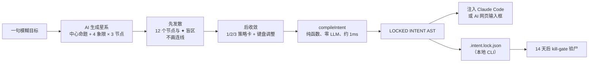
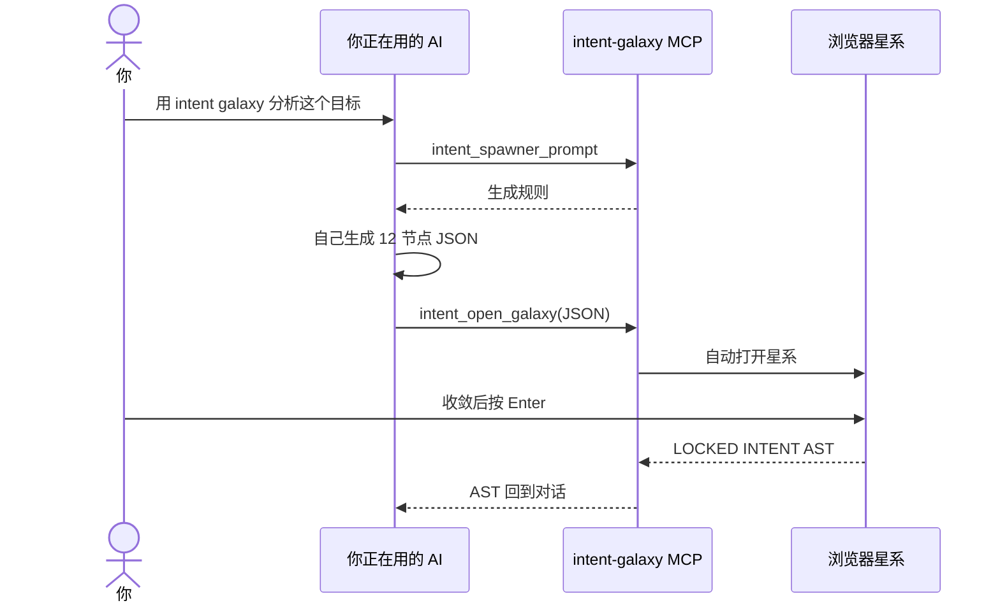
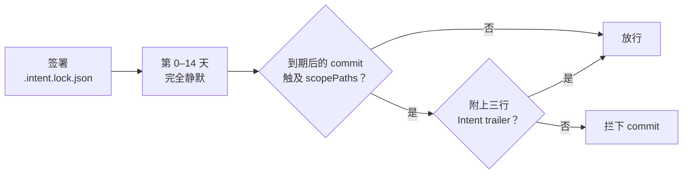
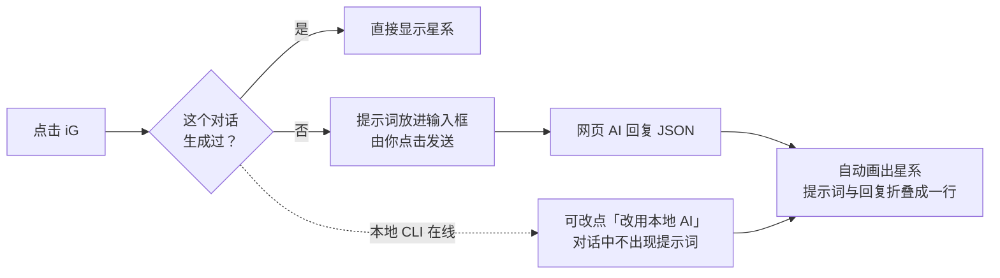

<p align="center">
  <picture>
    <source media="(prefers-color-scheme: dark)" srcset="https://raw.githubusercontent.com/stephen-taipei/intent-galaxy/main/docs/brand/intent-galaxy-logo-dark.svg">
    
  </picture>
</p>

<p align="center">
  <a href="https://github.com/stephen-taipei/intent-galaxy/blob/main/README.md">English</a> ·
  <a href="https://github.com/stephen-taipei/intent-galaxy/blob/main/README.zh-TW.md">繁體中文</a> ·
  <b>简体中文</b> ·
  <a href="https://github.com/stephen-taipei/intent-galaxy/blob/main/README.ja.md">日本語</a> ·
  <a href="https://github.com/stephen-taipei/intent-galaxy/blob/main/README.ko.md">한국어</a>
</p>

# Intent Galaxy

把一句模糊的目标展开成「中心命题 + 4 位对立专家 + 12 个思路节点」的星系图。先发散看见盲区，再用键盘 1 分钟收敛，
最后由**零 LLM 的纯函数编译器**生成确定性的 `LOCKED INTENT AST`，直接注入 Claude Code 或 AI 网页的输入框。

  

| 先发散：12 个节点与 ✦ 盲区，不画连线 | 后收敛：按 `1` 点亮主干，右侧实时编译 AST |
| --- | --- |
|  |  |

<p align="center">
  <a href="#快速开始">快速开始</a> ·
  <a href="#工作流程">工作流程</a> ·
  <a href="#支持的-ai">支持的 AI</a> ·
  <a href="#注册为-mcp">MCP</a> ·
  <a href="#14-天被动打脸kill-gate">Kill-gate</a> ·
  <a href="#键盘操作">键盘操作</a> ·
  <a href="#浏览器插件">浏览器插件</a> ·
  <a href="#开发">开发</a>
</p>

<br>

## 三种用法

| 形态 | 面向 | 内容 | 状态 |
| ---- | ---- | ---- | :--: |
| **CLI** | 工程师 | `npx @stephen.taipei/intent-galaxy`：127.0.0.1 星系服务器，可选 Claude、Codex、Gemini、agy CLI 或 12 家 API 生成 | ✅ |
| **MCP** | 工程师 | Stdio MCP Server：`intent_spawner_prompt` → `intent_open_galaxy`，Claude Code、Codex、Gemini CLI、agy 都能接入 | ✅ |
| **Extension** | 普通用户 | Chrome / Firefox：在 Claude、ChatGPT、Gemini、Grok、DeepSeek、Qwen、Perplexity、Copilot、Mistral、Kimi 输入框旁加上  **iG** 胶囊，直接让该网页的 AI 生成星系 | ✅ |
| **Kill-gate** | 工程师 | `.intent.lock.json`（RFC 8785 JCS + SHA-256）与 14 天后的 commit 验尸守门员 | ✅ |

<br>

---

## 工作流程



| 象限 | 角色 | 被 `x` 排除时 |
| :--: | ---- | ---- |
| Q1 | 归零者 | `MUST NOT` |
| Q2 | 老兵 | `MUST NOT` |
| Q3 | 越界者 | `MUST NOT` |
| Q4 | 验尸官（证伪节点） | `ACCEPTED RISK`（明确承担风险，而非禁止） |

<br>

---

## 快速开始

> 要求：Node ≥ 22.18。生成星系还需要下方[支持的 AI](#支持的-ai)中的任意一个（已登录的 CLI，或配置好的 API key）。

```bash
cd ~/code/some-repo
npx @stephen.taipei/intent-galaxy
```

打开 http://127.0.0.1:4787，输入一句目标，按 Enter 生成星系。

| 常用参数 | 用途 |
| --- | --- |
| `--port 4300` | 改用其他端口（默认 4787） |
| `--no-open` | 不自动打开浏览器 |
| `--provider gemini` | 指定默认 AI；网页右上角也可以切换 |
| `--model <id>` | 指定模型（也可用 `INTENT_GALAXY_MODEL`） |

| 行为 | 说明 |
| --- | --- |
| 网络 | 只绑定 `127.0.0.1`；每个请求都会校验 Host（防 DNS rebinding）、POST 来源与路径穿越 |
| API key | 只从环境变量读取，留在本地服务器，不会发送到浏览器 |
| AI 选择 | 网页顶部可选择 AI 与模型，检测不到的选项会标明缺少什么（例如「请设置 OPENAI_API_KEY」） |
| 速度 | Claude CLI 默认使用 Opus，大约需要 3–4 分钟 |
| 锁定 | 按 Enter 锁定时，会在当前目录写入 `.intent.lock.json` |

<br>

---

## 支持的 AI

| 类型 | 提供商（`--provider`） | 要求 |
| --- | --- | --- |
| 本地 CLI（无需 API key） | `claude` Claude Code、`codex` OpenAI Codex、`gemini` Gemini CLI、`agy` Antigravity | 已登录的 CLI 位于 `PATH` 中 |
| 本地开源模型 | `ollama`（Llama、Qwen、Gemma…） | Ollama 正在 `127.0.0.1:11434` 运行 |
| 其他 | `custom` 任意 OpenAI 兼容端点 | `INTENT_GALAXY_OPENAI_BASE_URL`（可选 `INTENT_GALAXY_OPENAI_API_KEY`） |

**API 提供商**

| `--provider` | 模型 | 环境变量 |
| --- | --- | --- |
| `anthropic` | Claude | `ANTHROPIC_API_KEY` |
| `openai` | GPT | `OPENAI_API_KEY` |
| `google` | Gemini | `GEMINI_API_KEY` |
| `xai` | Grok | `XAI_API_KEY` |
| `deepseek` | DeepSeek | `DEEPSEEK_API_KEY` |
| `mistral` | Mistral | `MISTRAL_API_KEY` |
| `qwen` | 通义千问 | `DASHSCOPE_API_KEY` |
| `moonshot` | Kimi | `MOONSHOT_API_KEY` |
| `groq` | Groq | `GROQ_API_KEY` |
| `openrouter` | OpenRouter | `OPENROUTER_API_KEY` |

API 提供商的模型列表会实时向提供商查询。CLI 以只读／规划模式运行，不会修改文件。

<br>

---

## 注册为 MCP

支持 Claude Code、Codex、Gemini CLI、agy：

```bash
claude mcp add intent-galaxy -- npx -y @stephen.taipei/intent-galaxy
codex mcp add intent-galaxy -- npx -y @stephen.taipei/intent-galaxy
gemini mcp add intent-galaxy npx -y @stephen.taipei/intent-galaxy
agy mcp add intent-galaxy npx -y @stephen.taipei/intent-galaxy
```

在对话中让它「用 intent galaxy 分析这个目标」。星系由你正在使用的这个 AI（Claude Code、Codex 等）自己生成，不会额外调用其他模型：



<br>

---

## 14 天被动打脸（kill-gate）

```bash
npx @stephen.taipei/intent-galaxy init-hook
```

| 安装位置 | 做法 |
| --- | --- |
| `.intent/hooks/` | 复制 `kill-gate.mjs` |
| `commit-msg` | 已有 husky 则追加到 `.husky/commit-msg`；否则在 `core.hooksPath` 为空时设为 `.intent/hooks` |
| GitHub PR | 检查 `intent-kill` |
| Claude Code | `SessionStart` hook |



到期后触及 `scopePaths` 的 commit 必须附上：

```text
Intent-Lock: <specHash>
Intent-Kill: alive|dead|unobservable
Intent-Kill-Evidence: <至少 12 字：你看到的数，或你缺的那个数>
```

<br>

---

## 键盘操作

| 类别 | 按键 | 动作 |
| :--- | :--- | :--- |
| 策略 | `1` `2` `3` | 应用 alpha / beta / gamma 策略卡（保留手动覆盖）；`Shift` + 数字清空覆盖 |
| 导航 | `h` `j` `k` `l` | 按极坐标半平面最近邻移动焦点 |
| 导航 | `g` + `f/d/l/p` + `1-3` | 直达象限节点（`g l 1` → N7） |
| 决策 | `Space` / `i` | 采纳（include） |
| 决策 | `x` | 排除护栏；Q4 节点为「明确承担风险」 |
| 决策 | `0` / `n` | 本次忽略 |
| 冲突 | `c` / `r` | 跳到冲突节点 / 保留较新的决定以解除冲突 |
| 历史 | `u` / `Ctrl+r` | 撤销 / 重做 |
| 结束 | `Enter` / `Esc` | 锁定并注入 / 关闭面板 |

> 开启拼音、五笔等中文输入法时同样可用（读取 `e.code`）。

<br>

---

## 浏览器插件

```bash
npm run build:ext    # 同步到 apps/extension 与 apps/extension-firefox，可直接「加载已解压的扩展程序」
npm run pack:ext     # 另外生成 dist-ext/intent-galaxy-{chrome,firefox}-<version>.zip 用于上架
```

在输入框里写下一件你正在犹豫的事，点击  **iG**（或工具栏图标、`Cmd/Ctrl+Shift+G`）：



| 功能 | 说明 |
| --- | --- |
| 生成来源 | 默认让当前网页的 AI 生成（能看到对话上文）；本地 CLI 在线时多一个「改用本地 AI」按钮。插件不会自动发送 |
| 折叠 | 只折叠插件自己发送、能确认身份的那一条；识别不出网站结构时不折叠，点一下可展开 |
| 等待 | 推理型高端模型可能需要 5–15 分钟；超过 20 秒会提示，可先缩小面板，完成时按钮显示「✓ 星系完成」 |
| 读不到回复 | 网站把长代码块折叠时，点「粘贴 JSON」手动加载 |
| 记忆 | 同一个对话重新打开或刷新会直接显示已生成的星系；只保存在插件内，保留 30 天；无痕窗口与 ChatGPT 临时对话不保存 |
| 隐私 | 面板与网页之间只走插件内部消息，网站自己的脚本读不到你的问题与星系 |
| 锁文件 | 只有本地 CLI 生成的星系会写入 `.intent.lock.json`；网页 AI、粘贴或示例的星系只把方案填回输入框 |
| 面板 | 拖动标题栏移动、拖动右下角缩放、双击标题栏最大化，可调透明度 |
| 示例 | 输入框为空时提供 3 个无需等待的示例：挑洗碗机、酸甜又没负担的食物、多主题前端架构 |

<br>

---

## 开发

| 命令 | 用途 |
| --- | --- |
| `npm test` | libs 单元测试、CLI 集成测试、插件同步、npm pack 端到端测试 |
| `npm start` | 直接从源码启动（由 Node 运行时剥离 TypeScript 类型） |
| `npm run build` | 生成 `dist/`（npm 包内容；npm pack / publish 前会自动执行） |
| `npm run bench:latency -- --providers claude,codex` | 用固定的 10 道题测量生成延迟（会实际调用模型），结果写入 `bench/latency.jsonl` |

架构与数据结构以 [`INTENT-SPEC-FINAL.md`](INTENT-SPEC-FINAL.md) 为准。

README 有五种语言；修改其中一份时，`README.md`、`README.zh-TW.md`、`README.zh-CN.md`、`README.ja.md`、`README.ko.md` 都要一起修改（`npm test` 会检查结构是否一致）。

### 发版

1. 更新 `package.json` 版本号与 [`CHANGELOG.md`](CHANGELOG.md)（新增 `## X.Y.Z — 日期` 段落），执行 `npm run build:ext` 让插件 manifest 版本号同步对齐（`npm test` 会检查），合并到 `main`
2. 在 `main` 上执行 `npm publish --access public`
3. `git tag vX.Y.Z && git push origin vX.Y.Z`：[Release workflow](.github/workflows/release.yml) 会确认 tag、`package.json` 与 npm 版本一致，再用 CHANGELOG 对应段落创建 GitHub Release（不会发布到 npm）

<br>

---

## License

[Apache-2.0](LICENSE)
