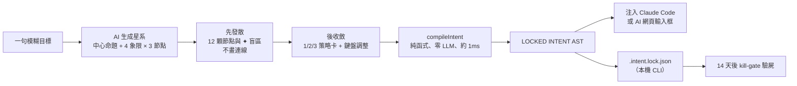
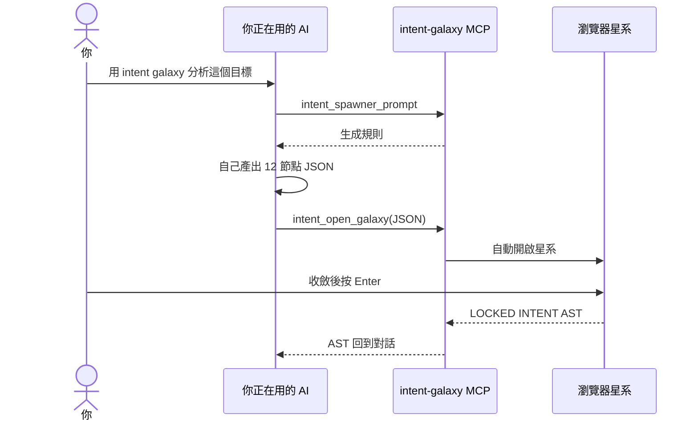
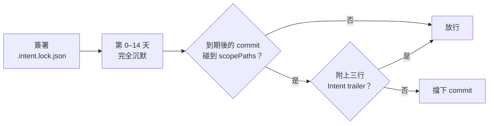
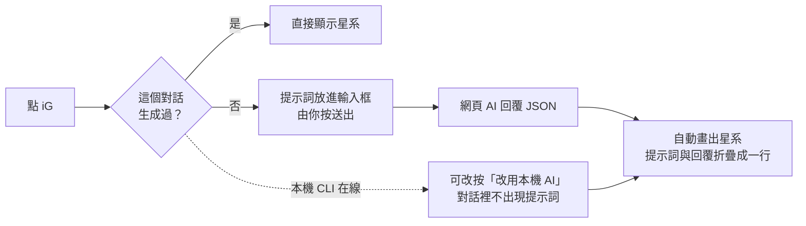

<p align="center">
  <picture>
    <source media="(prefers-color-scheme: dark)" srcset="https://raw.githubusercontent.com/stephen-taipei/intent-galaxy/main/docs/brand/intent-galaxy-logo-dark.svg">
    
  </picture>
</p>

<p align="center">
  <a href="https://github.com/stephen-taipei/intent-galaxy/blob/main/README.md">English</a> ·
  <b>繁體中文</b> ·
  <a href="https://github.com/stephen-taipei/intent-galaxy/blob/main/README.zh-CN.md">简体中文</a> ·
  <a href="https://github.com/stephen-taipei/intent-galaxy/blob/main/README.ja.md">日本語</a> ·
  <a href="https://github.com/stephen-taipei/intent-galaxy/blob/main/README.ko.md">한국어</a>
</p>

# Intent Galaxy

把一句模糊目標展開成「中心命題 + 4 位敵對專家 + 12 顆思緒節點」的星系圖。先發散看見盲區，再用鍵盤 1 分鐘收斂，
最後由**零 LLM 的純函式編譯器**產出確定性的 `LOCKED INTENT AST`，直接注入 Claude Code 或 AI 網頁的輸入框。

  

| 先發散：12 顆節點與 ✦ 盲區，不畫連線 | 後收斂：按 `1` 點亮主幹，右側即時編譯 AST |
| --- | --- |
|  |  |

<p align="center">
  <a href="#快速開始">快速開始</a> ·
  <a href="#運作流程">運作流程</a> ·
  <a href="#支援的-ai">支援的 AI</a> ·
  <a href="#註冊為-mcp">MCP</a> ·
  <a href="#14-天被動打臉kill-gate">Kill-gate</a> ·
  <a href="#鍵盤流">鍵盤流</a> ·
  <a href="#瀏覽器擴充功能">擴充功能</a> ·
  <a href="#開發">開發</a>
</p>

<br>

## 三種用法

| 形態 | 給誰 | 內容 | 狀態 |
| ---- | ---- | ---- | :--: |
| **CLI** | 工程師 | `npx @stephen.taipei/intent-galaxy`：127.0.0.1 星系伺服器，可選 Claude、Codex、Gemini、agy CLI 或 12 家 API 生成 | ✅ |
| **MCP** | 工程師 | Stdio MCP Server：`intent_spawner_prompt` → `intent_open_galaxy`，Claude Code、Codex、Gemini CLI、agy 都能掛 | ✅ |
| **Extension** | 一般使用者 | Chrome / Firefox：在 Claude、ChatGPT、Gemini、Grok、DeepSeek、Qwen、Perplexity、Copilot、Mistral、Kimi 輸入框旁加  **iG** 膠囊，直接請該網頁的 AI 生成星系 | ✅ |
| **Kill-gate** | 工程師 | `.intent.lock.json`（RFC 8785 JCS + SHA-256）與 14 天後的 commit 驗屍守門員 | ✅ |

<br>

---

## 運作流程



| 象限 | 角色 | 被 `x` 排除時 |
| :--: | ---- | ---- |
| Q1 | 歸零者 | `MUST NOT` |
| Q2 | 老兵 | `MUST NOT` |
| Q3 | 越界者 | `MUST NOT` |
| Q4 | 驗屍官（證偽節點） | `ACCEPTED RISK`（明示承擔風險，不是禁止） |

<br>

---

## 快速開始

> 需求：Node ≥ 22.18。星系生成另需下方[支援的 AI](#支援的-ai)任一個（已登入的 CLI，或設定好 API key）。

```bash
cd ~/code/some-repo
npx @stephen.taipei/intent-galaxy
```

開啟 http://127.0.0.1:4787，輸入一句目標按 Enter 生成星系。

| 常用參數 | 用途 |
| --- | --- |
| `--port 4300` | 改用其他 port（預設 4787） |
| `--no-open` | 不自動開瀏覽器 |
| `--provider gemini` | 指定預設 AI；網頁右上角也能切換 |
| `--model <id>` | 指定模型（也可用 `INTENT_GALAXY_MODEL`） |

| 行為 | 說明 |
| --- | --- |
| 網路 | 只綁 `127.0.0.1`；每個請求檢查 Host（防 DNS rebinding）、POST 來源與路徑穿越 |
| API key | 只從環境變數讀取，留在本機伺服器，不會送進瀏覽器 |
| AI 選擇 | 網頁頂部可選 AI 與模型，偵測不到的選項會標出缺什麼（例如「請設定 OPENAI_API_KEY」） |
| 速度 | Claude CLI 預設 Opus，約需 3–4 分鐘 |
| 鎖定 | 按 Enter 鎖定時，在目前目錄寫入 `.intent.lock.json` |

<br>

---

## 支援的 AI

| 類型 | 供應商（`--provider`） | 需要 |
| --- | --- | --- |
| 本機 CLI（免 API key） | `claude` Claude Code、`codex` OpenAI Codex、`gemini` Gemini CLI、`agy` Antigravity | 已登入的 CLI 在 `PATH` 上 |
| 本機開源模型 | `ollama`（Llama、Qwen、Gemma…） | Ollama 在 `127.0.0.1:11434` 執行中 |
| 其他 | `custom` 任何 OpenAI 相容端點 | `INTENT_GALAXY_OPENAI_BASE_URL`（可選 `INTENT_GALAXY_OPENAI_API_KEY`） |

**API 供應商**

| `--provider` | 模型 | 環境變數 |
| --- | --- | --- |
| `anthropic` | Claude | `ANTHROPIC_API_KEY` |
| `openai` | GPT | `OPENAI_API_KEY` |
| `google` | Gemini | `GEMINI_API_KEY` |
| `xai` | Grok | `XAI_API_KEY` |
| `deepseek` | DeepSeek | `DEEPSEEK_API_KEY` |
| `mistral` | Mistral | `MISTRAL_API_KEY` |
| `qwen` | 通義千問 | `DASHSCOPE_API_KEY` |
| `moonshot` | Kimi | `MOONSHOT_API_KEY` |
| `groq` | Groq | `GROQ_API_KEY` |
| `openrouter` | OpenRouter | `OPENROUTER_API_KEY` |

API 供應商的模型清單會即時向供應商查詢。CLI 以唯讀／規劃模式執行，不會改動檔案。

<br>

---

## 註冊為 MCP

支援 Claude Code、Codex、Gemini CLI、agy：

```bash
claude mcp add intent-galaxy -- npx -y @stephen.taipei/intent-galaxy
codex mcp add intent-galaxy -- npx -y @stephen.taipei/intent-galaxy
gemini mcp add intent-galaxy npx -y @stephen.taipei/intent-galaxy
agy mcp add intent-galaxy npx -y @stephen.taipei/intent-galaxy
```

在對話裡請它「用 intent galaxy 分析這個目標」。星系由你正在用的這個 AI（Claude Code、Codex 等）自己生成，不會另外呼叫其他模型：



<br>

---

## 14 天被動打臉（kill-gate）

```bash
npx @stephen.taipei/intent-galaxy init-hook
```

| 安裝位置 | 做法 |
| --- | --- |
| `.intent/hooks/` | 複製 `kill-gate.mjs` |
| `commit-msg` | 已有 husky 就追加到 `.husky/commit-msg`；否則在 `core.hooksPath` 為空時設成 `.intent/hooks` |
| GitHub PR | 檢查 `intent-kill` |
| Claude Code | `SessionStart` hook |



到期後碰到 `scopePaths` 的 commit 必須附上：

```text
Intent-Lock: <specHash>
Intent-Kill: alive|dead|unobservable
Intent-Kill-Evidence: <至少 12 字：你看到的數，或你缺的那個數>
```

<br>

---

## 鍵盤流

| 類別 | 按鍵 | 動作 |
| :--- | :--- | :--- |
| 策略 | `1` `2` `3` | 套用 alpha / beta / gamma 策略卡（保留手動覆寫）；`Shift` + 數字清空覆寫 |
| 導航 | `h` `j` `k` `l` | 依極座標半平面最近鄰移動焦點 |
| 導航 | `g` + `f/d/l/p` + `1-3` | 直達象限節點（`g l 1` → N7） |
| 決策 | `Space` / `i` | 採納（include） |
| 決策 | `x` | 排除護欄；Q4 節點為「明示承擔風險」 |
| 決策 | `0` / `n` | 本次忽略 |
| 衝突 | `c` / `r` | 跳到衝突節點 / 保留較新決定解除衝突 |
| 歷史 | `u` / `Ctrl+r` | 復原 / 重做 |
| 結束 | `Enter` / `Esc` | 鎖定並注入 / 關閉面板 |

> 注音、倉頡等中文輸入法開啟時同樣可用（讀取 `e.code`）。

<br>

---

## 瀏覽器擴充功能

```bash
npm run build:ext    # 同步到 apps/extension 與 apps/extension-firefox，可直接「載入未封裝項目」
npm run pack:ext     # 另外產出 dist-ext/intent-galaxy-{chrome,firefox}-<version>.zip 供上架
```

在輸入框打一句你正在猶豫的事，點  **iG**（或工具列圖示、`Cmd/Ctrl+Shift+G`）：



| 功能 | 說明 |
| --- | --- |
| 生成來源 | 預設請當前網頁的 AI（看得到對話前文）；本機 CLI 在線時多一個「改用本機 AI」按鈕。擴充功能不會自動送出 |
| 折疊 | 只折疊擴充功能自己送出、能確認身分的那一則；認不出網站結構時不折疊，點一下可展開 |
| 等待 | 推理型高階模型可能要 5–15 分鐘；超過 20 秒會提示，可先縮小面板，完成時按鈕顯示「✓ 星系完成」 |
| 讀不到回覆 | 網站把長程式碼區塊收合時，按「貼上 JSON」手動載入 |
| 記憶 | 同一個對話重新打開或重新整理會直接顯示已生成的星系；只存在擴充功能裡，保存 30 天；無痕視窗與 ChatGPT 暫時對話不保存 |
| 隱私 | 面板與網頁之間只走擴充功能內部訊息，網站自己的腳本讀不到你的問題與星系 |
| 鎖檔 | 只有本機 CLI 生成的星系會寫入 `.intent.lock.json`；網頁 AI、貼上或示範的星系只把方案填回輸入框 |
| 面板 | 拖曳標題列移動、拖右下角縮放、雙擊標題列放大，可調透明度 |
| 示範 | 輸入框空白時提供 3 個免等待的示範：挑洗碗機、酸甜又不負擔的食物、多主題前端架構 |

<br>

---

## 開發

| 指令 | 用途 |
| --- | --- |
| `npm test` | libs 單元測試、CLI 整合測試、擴充功能同步、npm pack 端到端 |
| `npm start` | 直接從原始碼啟動（Node 執行期剝除 TypeScript 型別） |
| `npm run build` | 產生 `dist/`（npm 套件內容；npm pack / publish 前會自動執行） |
| `npm run bench:latency -- --providers claude,codex` | 以固定 10 題量測生成延遲（會實際呼叫模型），結果寫到 `bench/latency.jsonl` |

架構與資料結構以 [`INTENT-SPEC-FINAL.md`](INTENT-SPEC-FINAL.md) 為準。

README 有五種語言；修改其中一份時，`README.md`、`README.zh-TW.md`、`README.zh-CN.md`、`README.ja.md`、`README.ko.md` 都要一起改（`npm test` 會檢查結構一致）。

### 發版

1. 更新 `package.json` 版本與 [`CHANGELOG.md`](CHANGELOG.md)（新增 `## X.Y.Z — 日期` 段落），執行 `npm run build:ext` 讓擴充功能 manifest 版號跟著對齊（`npm test` 會檢查），合併到 `main`
2. 在 `main` 上 `npm publish --access public`
3. `git tag vX.Y.Z && git push origin vX.Y.Z`：[Release workflow](.github/workflows/release.yml) 會確認 tag、`package.json` 與 npm 版本一致，再以 CHANGELOG 該段建立 GitHub Release（不會發佈 npm）

<br>

---

## License

[Apache-2.0](LICENSE)
